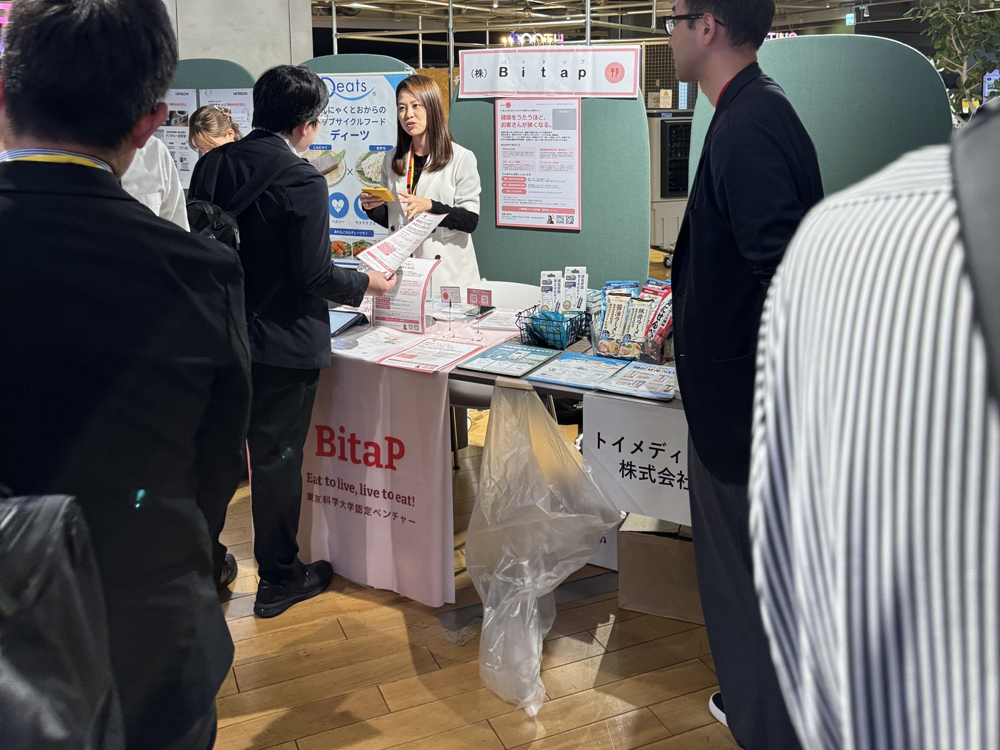
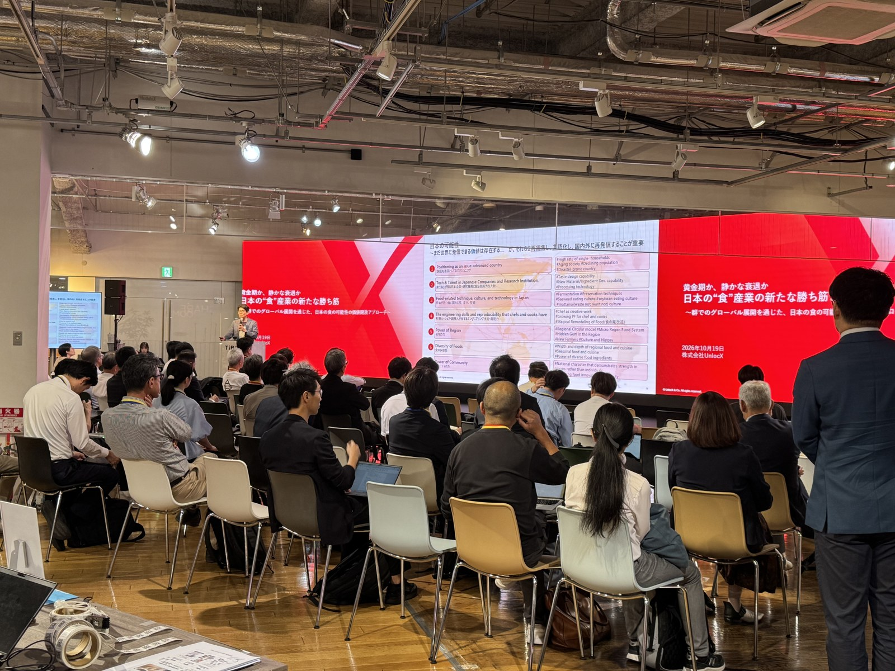

2026年10月19日、株式会社BitaPは、Tokyo Innovation Base（東京都千代田区）で開催された「フードテック官民協議会 第2回総会／提案・報告会」にブースを出展しました。

今回の総会は「フードテック市場の成長と販路拡大～国内・海外市場の獲得に向けて～」をテーマに開催され、販路拡大を目指す会員による展示ブースが設けられました。

ブースでは、「新しい切り口でヘルスケアを語りたい企業さんへ」と題したポスターと資料を用意し、「健康をうたうほど、お客さんが狭くなる。」というメッセージとともに、BitaPの取り組みをご紹介しました。

ご紹介したのは、腸活の社内研修、腸活関連の研究計画・戦略立案、社食・メニューの監修、ケータリング・お弁当です。社食・メニューの監修では、約2年前から全国約40拠点の社員食堂での腸活フェアに関わっており、もうすぐ第8回を迎えます。また、“口福”なコンビニランチを選ぶためのテストアプリの実演も行いました。

BitaPが目指しているのは、「好きなものを食べて飲みながら、頑張れる体を作る。」こと。そのための食べ方を、腸内細菌の研究でわかってきたことをもとに提案しています。

当日は、ブースに立ち寄ってくださった方に、代表の千葉が資料をお渡ししながらご説明しました。

BitaPはこれからも、腸内環境への配慮だけでなく、彩りや楽しさ、おいしさを大切にした「健康なだけではない、口福な食事」を通じて、豊かな食体験を届けてまいります。

BitaPの取り組みにご関心のある方は、以下よりぜひご連絡ください。

お問い合わせ → info@bitap.co.jp

